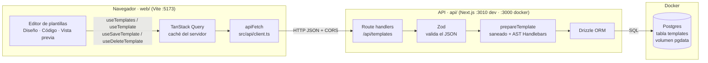
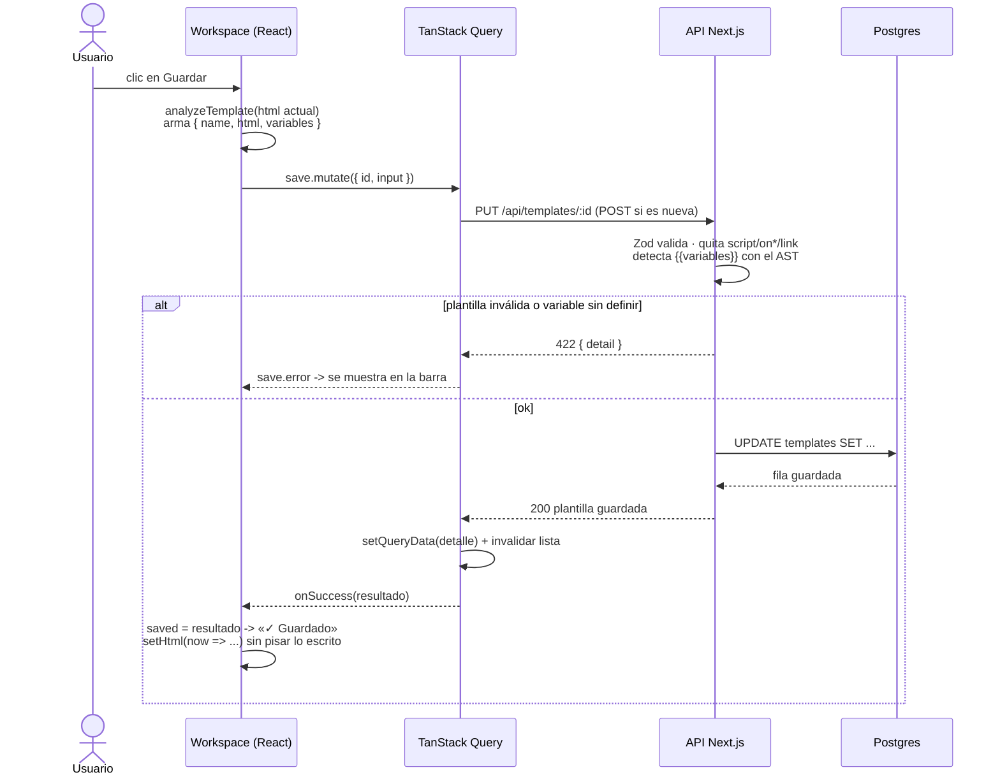
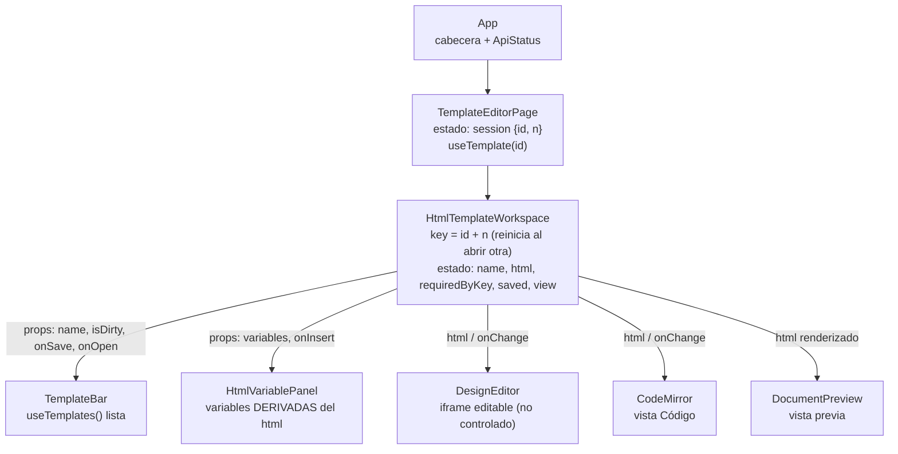
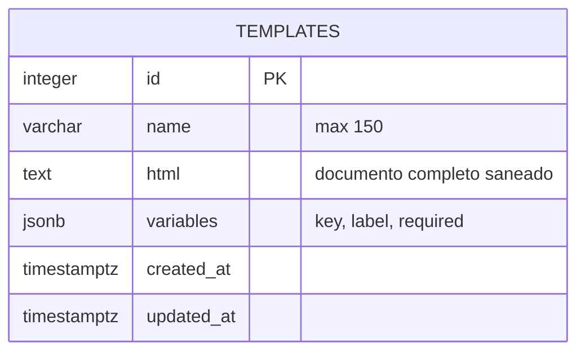

# React Fullstack App

Monorepo de práctica: **generador de documentos**. Editor de plantillas HTML con comodines Handlebars
`{{variable}}`, formulario dinámico (próximo) y generación de PDF con Playwright (próximo).

| Carpeta | Stack |
|---|---|
| `web/` | Vite + React 19 + TypeScript + TanStack Query + CodeMirror + Handlebars |
| `api/` | Next.js (route handlers) + TypeScript + Drizzle + Zod, dockerizada (Postgres en compose) |

## Arquitectura



### Qué pasa al pulsar «Guardar»



### Componentes y estado del front



- **Fuente de verdad única**: `html` en el workspace; variables, vista previa y «sin guardar» son **derivados**.
- **Estado del servidor** (plantillas) en la caché de TanStack Query; **estado del borrador** en `useState`.

### Modelo de datos



## Arrancar

```bash
# API + Postgres (Docker)
cp api/.env.example api/.env
docker compose up --build        # http://localhost:3000/api/health

# Front
cd web
npm install
npm run dev                      # http://localhost:5173
```

Si 3000/5432 están ocupados: `DB_PORT=55432 API_PORT=3010 docker compose up --build`
y en `web/.env.local`: `VITE_API_URL=http://localhost:3010`.

### Desarrollo local (sin contenedor de API)

```bash
DB_PORT=55432 docker compose up -d db
cd api && npx drizzle-kit migrate && npm run dev -- -p 3010   # api/.env -> DATABASE_URL :55432
cd web && npm run dev -- --port 5173 --strictPort
cd web && npm run gen:api        # regenera src/api/schema.d.ts desde /api/openapi.json
```

## API

| Método | Ruta | Descripción |
|---|---|---|
| GET | `/api/health` | Estado |
| GET | `/api/templates` | Listar plantillas (sin `html`) |
| POST | `/api/templates` | Crear `{ name, html, variables }` |
| GET | `/api/templates/:id` | Obtener una plantilla |
| PUT | `/api/templates/:id` | Reemplazar `{ name, html, variables }` |
| DELETE | `/api/templates/:id` | Eliminar |
| POST | `/api/templates/:id/pdf` | Generar PDF `{ data }` -> `{ filename, pdfBase64 }` (Playwright) |
| GET | `/api/openapi.json` | Especificación OpenAPI |

- Comodín = expresión Handlebars en el HTML: `{{cliente-nombre}}`, `{{#if x}}`, `{{#each coberturas}}`.
- Variable: `{ key, label, required }` (`required` por defecto `true`). Claves tal cual: letras, números, `_` y `-`.
- Saneado **quirúrgico** al guardar: se quitan solo `script`, `iframe`, `link`, `meta http-equiv`, atributos `on*`
  y URLs `javascript:`; el resto del documento (`<style>`, clases, imágenes `data:`) queda byte a byte.
- Variables detectadas con el AST de Handlebars: solo se guardan las usadas; una sin definir o una plantilla
  inválida da 422. Errores: `{ detail }`.
- Cada plantilla (listado y detalle) trae `dataMapping`: el molde de datos para rellenarla, **calculado del HTML**
  (no se guarda, nunca se desfasa). Valores con `""`, listas con un elemento de ejemplo, `a.b` anidado:

```json
"dataMapping": {
  "asegurado": "",
  "tipo-poliza": "",
  "coberturas": [{ "codigo": "", "descripcion": "", "monto-asegurado": "", "porcentaje-prima": "" }]
}
```

## Desarrollo de la API

```bash
cd api
npm install
npm test                    # Vitest + PGlite (Postgres en memoria, sin Docker)
npm run db:generate         # nueva migración tras cambiar src/db/schema.ts
```
